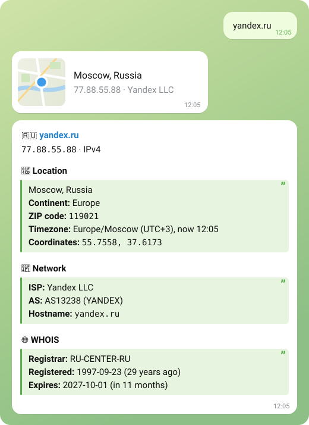

<div align="center">

# 🌍 IP Info Bot

**A Telegram bot that tells you everything about an IP address or domain**

Location on an interactive map · provider & AS · WHOIS · inline mode · 🇬🇧 English / 🇷🇺 Russian

[Features](#-features) •
[Quick start](#-quick-start) •
[Docker](#-docker) •
[Usage](#-usage) •
[How it works](#%EF%B8%8F-how-it-works) •
[FAQ](#-faq)

<br>



</div>

<br>

## ✨ Features

<table>
<tr>
<td width="50%" valign="top">

### 🔎 Any input
IPv4, IPv6, domains (even `пример.рф`), links like `https://site.com/page` and `host:port` — just paste it.

</td>
<td width="50%" valign="top">

### 🗺️ Interactive map
A Telegram map pin you can pinch and drag comes with every answer.

</td>
</tr>
<tr>
<td valign="top">

### 📍 Location
Country with flag, region, city, ZIP code, continent, timezone with the current local time and coordinates.

</td>
<td valign="top">

### 📡 Network
Internet provider, organization, autonomous system (AS) and hostname (PTR).

</td>
</tr>
<tr>
<td valign="top">

### 🌐 WHOIS for domains
Registrar, registration and expiry dates — with a ⚠️ warning when the domain expires within 30 days.

</td>
<td valign="top">

### 📱 Mobile networks
Flags addresses that belong to mobile networks.

</td>
</tr>
<tr>
<td valign="top">

### 💬 Inline mode
Type `@your_bot 8.8.8.8` in any chat and send the card right there — no need to open the bot.

</td>
<td valign="top">

### 🇷🇺 Two languages
English and Russian, picked automatically from the user's Telegram language — country and city names too.

</td>
</tr>
</table>

## 🚀 Quick start

> **You need:** Python 3.10+ and a bot token from [@BotFather](https://t.me/botfather).

**1. Install**

```bash
git clone https://github.com/CraftStick/IPBot-telegram.git
cd IPBot-telegram
pip install -r ipbot/requirements.txt
```

**2. Add your token** — either as an environment variable:

```bash
export BOT_TOKEN="123456:ABC-DEF..."
```

or in a config file (it's git-ignored, so the token never ends up in the repo):

```bash
cp ipbot/config.example.py ipbot/config.py   # then paste the token into config.py
```

**3. Run**

```bash
python ipbot/bot.py
```

> [!TIP]
> To make `@your_bot 8.8.8.8` work in any chat, send `/setinline` to [@BotFather](https://t.me/botfather), pick your bot and enter a placeholder like `IP address or domain`.

## 🐳 Docker

```bash
cp .env.example .env          # put your token into .env
docker compose up -d --build
```

The image contains only the bot code, runs as a non-root user and restarts automatically.

## 📖 Usage

Send the bot an IP address, a domain or a link — or use a command:

| Command | What it does |
|:--|:--|
| `/ip <address>` | Look up an IP address or domain |
| `/info <address>` | Same as `/ip` |
| `/help` | How to use the bot |
| `/start` | Welcome message |

**Try:** `8.8.8.8` · `2606:4700::1111` · `google.com` · `пример.рф` · `https://github.com/CraftStick`

In groups the bot answers only to commands, so it doesn't react to every message.

## ⚙️ How it works

| Data | Source | Notes |
|:--|:--|:--|
| Geolocation, ISP, AS, PTR, flags | [ip-api.com](https://ip-api.com) | Free, no key; 45 requests/min per bot — answers are cached for 5 min |
| Domain registration | [RDAP](https://about.rdap.org/) → classic WHOIS | RDAP where the zone supports it, otherwise port-43 WHOIS; `whois.nic.ru` as a backup for `.ru` / `.рф` / `.su` |
| Local time | [`tzdata`](https://pypi.org/project/tzdata/) | Works the same on Linux, macOS, Windows and in Docker |
| Telegram | [`pyTelegramBotAPI`](https://pypi.org/project/pyTelegramBotAPI/) | Long polling, no webhook or public server needed |

WHOIS is requested in parallel with the geolocation, so domains don't wait twice. Private and reserved addresses (`192.168.x.x`, `10.x.x.x`, `127.0.0.1`…) are rejected right away — they have no public location.

<details>
<summary><b>📁 Project structure</b></summary>

<br>

```
IPBot-telegram/
├── ipbot/
│   ├── bot.py              # Bot: handlers, card formatting, inline mode
│   ├── texts.py            # English and Russian texts
│   ├── domaininfo.py       # WHOIS / RDAP lookups
│   ├── config.example.py   # Config template (copy to config.py)
│   └── requirements.txt
├── tests/                  # pytest tests
├── docs/preview.svg        # Picture for this README
├── docs/pin.jpg            # Map pin picture for inline results (served via jsDelivr)
├── Dockerfile
├── docker-compose.yml
├── .env.example            # Token template for Docker
└── requirements-dev.txt    # Bot + pytest
```

</details>

<details>
<summary><b>🧪 Tests</b></summary>

<br>

```bash
pip install -r requirements-dev.txt
pytest
```

Tests need neither a bot token nor internet access: Telegram, ip-api and WHOIS servers are mocked.

</details>

## ❓ FAQ

<details>
<summary><b>Can the bot show my own IP?</b></summary>

<br>

No — Telegram never shares users' IP addresses with bots. Open [ifconfig.me](https://ifconfig.me) and send the address you see there to the bot.

</details>

<details>
<summary><b>How precise is the location?</b></summary>

<br>

City level at best. IP geolocation shows where the provider's network is registered, not where a person is — that's why the map shows an approximate point.

</details>

<details>
<summary><b>Why is there no WHOIS section for some domains?</b></summary>

<br>

Some zones (e.g. `.de`) don't publish registration dates at all. For `.ru` / `.рф` / `.su`, if the registry server is unreachable from your network, the backup `whois.nic.ru` only knows domains registered through RU-CENTER.

</details>

<details>
<summary><b>Something doesn't work</b></summary>

<br>

| Problem | Fix |
|:--|:--|
| `Bot token is not set` | Set `BOT_TOKEN` or create `ipbot/config.py` from `config.example.py` |
| `Unauthorized` on start | The token is wrong — get a new one from @BotFather |
| No answer to `/start` | Make sure the bot is running and the machine has internet access |
| `@your_bot` shows nothing in chats | Inline mode is off — enable it with `/setinline` in @BotFather |
| "Too many requests" | The ip-api limit (45 requests/min for the whole bot) was hit — wait a minute |

</details>

## 🤝 Contributing

Ideas and pull requests are welcome! Found a bug? [Open an issue](https://github.com/CraftStick/IPBot-telegram/issues).

1. Fork the repo and create a branch: `git checkout -b feature/my-idea`
2. Make sure `pytest` passes
3. Open a pull request

## 📄 License

[MIT](LICENSE) © [CraftStick](https://github.com/CraftStick)

<div align="center">

<br>

**If the bot was useful — give it a ⭐, it really helps!**

Если было полезно — поставь ⭐, это очень помогает!

</div>
